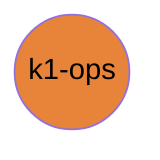

# k1-ops

Host launchers, containers, CI, job chains.

| | |
|---|---|
| Layer | **L3**: Apps (processes you start) |
| May import | nothing |
| Files / LOC | 68 files · 2,655 lines (py, sh, cpp) |
| Part of | [k1-workspace](https://github.com/thdhyan/k1-workspace) (architecture and layering rules live there) |

## Where it sits



Used by: nothing (top layer).


## Install

Not an installable library: clone it and run the scripts in place.
```bash
git clone https://github.com/thdhyan/k1-ops
```

## Usage

Host launchers, training containers and job chains.

```bash
docker/run.sh --task Isaac-Velocity-Flat-K1-Mjlab-v0 --num-envs 4096 --iters 3000   # clones k1-workspace in the container
docker/run.sh --source ...                                                          # bind-mount this checkout instead
```
- `scripts/remote_train.sh`: run an mjlab training (k1-rl-mj) on any SSH host with a CUDA GPU. No host is built in:
  list yours in `K1_HOSTS`.
  ```bash
  export K1_HOSTS="gpu-host-1 gpu-host-2"          # ssh aliases / names; key login required
  scripts/remote_train.sh pick                     # first host with an idle GPU -> "<host> <gpu>"
  scripts/remote_train.sh up Mjlab-PushIK-Booster-K1 --name pik_try1 -- --agent.max-iterations 3000
  scripts/remote_train.sh status pik_try1          # RUNNING / FINISHED, last log lines, GPU use
  scripts/remote_train.sh fetch pik_try1           # checkpoints + log -> $K1_MODELS_DIR/mjlab_k1/pik_try1
  scripts/remote_train.sh stop pik_try1
  ```
  `up` copies the five source libraries to `~/k1_run/<name>/` on the host, builds one shared venv there (third-party
  deps only, rebuilt when they change), and starts `k1-train` in tmux. The host needs python3, tmux and an NVIDIA
  driver. `K1_NUM_ENVS` defaults to 1024 (sized for a 16 GB GPU). `K1_DRY_RUN=1` prints every command without running
  it. Hosts that refuse a key login are skipped; if a host says "Too many authentication failures", put
  `IdentitiesOnly yes` and the right `IdentityFile` for it in `~/.ssh/config`.
- `docker/entrypoint.sh` supports two layouts, set with `K1_LAYOUT`. `workspace` (the default) fetches only
  description, common, utils, runtime and rl-isaac. `legacy` is the old `booster_ws`.
- `apptainer/` holds the Singularity build for hosts without Docker.
- **Legacy, not ported yet:** most `scripts/spark_*_host.sh`, `dl_*_host.sh`, `phase6_env.sh` and
  `dl_k1_teleop_up.sh` still assume `booster_ws` paths and container scripts next to them. Those scripts now live in
  k1-rl-isaac `jobs/`.

Hosts: [docs/ROBOTS.md section 8](https://github.com/thdhyan/k1-workspace/blob/main/docs/ROBOTS.md).

## Tests

No tests yet.

## Robots and hosts

Robot IPs, SSH aliases, network, safety and how to control each robot: [docs/ROBOTS.md](https://github.com/thdhyan/k1-workspace/blob/main/docs/ROBOTS.md) in k1-workspace.

## Environment variables read

`K1_BASE_CKPT`, `K1_CACHE_DIR`, `K1_CLONE`, `K1_CV_BASE`, `K1_DRY_RUN`, `K1_ENABLE_CAMERAS`, `K1_GIT_BRANCH`, `K1_GPU`, `K1_HOSTS`, `K1_IMAGE`, `K1_KICK_CMD_ALPHA`, `K1_KICK_GATE`, `K1_KICK_RESIDUAL`, `K1_KMA_BASE`, `K1_LAYOUT`, `K1_MAX_GPU_MEM_MB`, `K1_MODELS_DIR`, `K1_MOUNT_DIR`, `K1_NUM_ENVS`, `K1_PHYSICS`, `K1_REMOTE_DIR`, `K1_REPO_URL`, `K1_ROS_DOMAIN_ID`, `K1_RUNS_FILE`, `K1_SMOKE_LOG`, `K1_SOURCE_ROS`, `K1_STEPS_BASE_CKPT`, `K1_SYNC_SRC`, `K1_TEACHER_PRESET`, `K1_TORCH_VENV`, `K1_TRAIN_SCRIPT`, `K1_USE_MOUNT`, `K1_WORKDIR`, `K1_WORKSPACE`

## Layout

```
README.md
docker/  (5 files)
  Dockerfile
  README.md
  apptainer/  (1 files)
  entrypoint.sh
  run.sh
pyproject.toml
scripts/  (63 files)
  README.md
  chain_p4_p2_host.sh
  chain_train.sh
  diag_frozen.sh
  dl_ab_push_frict_host.sh
  dl_ab_push_stiff_host.sh
  dl_ab_push_wiring_host.sh
  dl_eval_skills.sh
  dl_k1_teleop_up.sh
  dl_push_base_resume_host.sh
  dl_push_chain2_host.sh
  dl_push_chain3_host.sh
  dl_push_chain_host.sh
  dl_push_host.sh
  dl_record_push_host.sh
  dl_skills_v2.sh
  docker_isaac_fleet.sh
  install_phase6_env.sh
  k1_launch_hrl.sh
  k1_train_status.sh
  launch_dl_batch.sh
  phase6_env.sh
  probe_rewards_host.sh
  push_base_chain_host.sh
  push_ik_fetch_upload.sh
  py_torch.sh
  record_p2_final_host.sh
  record_p2_one_host.sh
  record_policies_host.sh
  remote_train.sh
  setup_remote.sh
  spark_force_host.sh
  spark_full_host.sh
  spark_p2_dispcheck_host.sh
  spark_p2_gait_host.sh
  spark_p2_gaitfix_host.sh
  spark_p2_velcurriculum_host.sh
  spark_p2_velresume_host.sh
  spark_partial_host.sh
  spark_probe.sh
  spark_probe2.sh
  spark_probe3.sh
  spark_push_base_host.sh
  spark_push_host.sh
  spark_s0_container.sh
  spark_s0_host.sh
  spark_s1_host.sh
  spark_s2_host.sh
  spark_soccer_host.sh
  spark_sync_loop.sh
  start_training.sh
  sweep_standing_host.sh
  tmux_train.sh
  track_a_recovery_host.sh
  train_guard.sh
  wait_skills.sh
  wait_v10_v4.sh
  zzbw_kick_ma_v1.sh
  zzbw_kick_ma_v2.sh
  zzbw_kick_ma_v3.sh
  zzbw_kick_strike_v1.sh
  zzbw_push_chain_host.sh
  zzbw_push_smoke.sh
```

## Dependencies

- Declared sibling libraries: none (see `pyproject.toml`, `[tool.uv.sources]`).
- PyPI: none detected.
- Provided by the environment (ROS 2, Isaac, mjlab, robot SDK) or unresolved: none.

## Hard-coded paths into other repos

These files still name paths that now live in another repo (hard-coded path strings, not imports). Pass them as arguments / config when you touch the file:

| File | Refers to | Owner |
|---|---|---|
| `.github/workflows/train_smoke.yml` | `isaac_tasks/` | k1-rl-isaac |
| `docker/entrypoint.sh` | `isaac_tasks/` | k1-rl-isaac |
| `scripts/dl_k1_teleop_up.sh` | `k1_teleop/` | k1-teleop |
| `scripts/phase6_env.sh` | `isaac_tasks/` | k1-rl-isaac |
| `scripts/push_ik_fetch_upload.sh` | `mjlab_k1/` | k1-rl-mj |
| `scripts/record_p2_final_host.sh` | `isaac_tasks/` | k1-rl-isaac |
| `scripts/record_p2_one_host.sh` | `isaac_tasks/` | k1-rl-isaac |
| `scripts/remote_train.sh` | `mjlab_k1/` | k1-rl-mj |
| `scripts/start_training.sh` | `isaac_tasks/` | k1-rl-isaac |
| `scripts/zzbw_push_chain_host.sh` | `isaac_tasks/` | k1-rl-isaac |

## Old `booster_ws` layout still referenced

These files still name `booster_ws`, `isaac_tasks/` or `booster_train_ref` paths (container scripts not ported yet, or docstrings):

- `.github/workflows/train_smoke.yml`
- `docker/apptainer/zzbw_run_k1_train.sh`
- `docker/entrypoint.sh`
- `docker/run.sh`
- `scripts/chain_p4_p2_host.sh`
- `scripts/diag_frozen.sh`
- `scripts/dl_ab_push_frict_host.sh`
- `scripts/dl_ab_push_stiff_host.sh`
- `scripts/dl_ab_push_wiring_host.sh`
- `scripts/dl_k1_teleop_up.sh`
- `scripts/dl_push_base_resume_host.sh`
- `scripts/dl_push_chain2_host.sh`
- `scripts/dl_push_chain3_host.sh`
- `scripts/dl_push_chain_host.sh`
- `scripts/dl_push_host.sh`
- `scripts/dl_record_push_host.sh`
- `scripts/docker_isaac_fleet.sh`
- `scripts/launch_dl_batch.sh`
- `scripts/phase6_env.sh`
- `scripts/probe_rewards_host.sh`
- `scripts/push_base_chain_host.sh`
- `scripts/record_p2_final_host.sh`
- `scripts/record_p2_one_host.sh`
- `scripts/record_policies_host.sh`
- `scripts/setup_remote.sh`
- `scripts/spark_force_host.sh`
- `scripts/spark_full_host.sh`
- `scripts/spark_p2_dispcheck_host.sh`
- `scripts/spark_p2_gait_host.sh`
- `scripts/spark_p2_gaitfix_host.sh`
- …and 14 more

## Origin

Extracted from `booster_ws` (branch `dev/push-training-wip`, working tree of 2026-11-03) by
`tools/build_workspace.py` in k1-workspace. Old path to new path for every file: [`docs/migration_map.tsv`](https://github.com/thdhyan/k1-workspace/blob/main/docs/migration_map.tsv) (filter on `k1-ops`).
History was not carried over: the working tree was copied as is, including previously untracked files.
